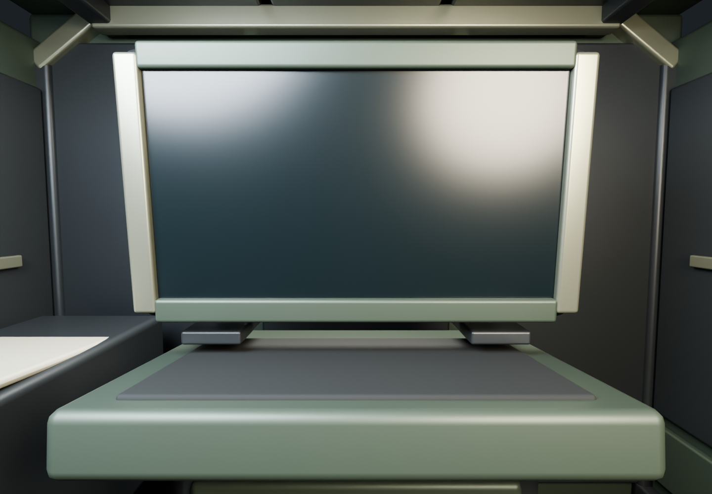

# IRON DUST — Kabin iç gövdesi v01

2026-10-24 · `docs/CABIN.md` bölüm 1 doğrultusunda Blender MCP ile üretilen ilk iç gövde ve ana konsol. Oyun kodu değiştirilmedi.

[Blender kaynağı](cockpit.blend) · [GLB](cockpit.glb) · [Sağ çalışma alanı](previews/right_work_area.png) · [Doğrulama kaydı](validation.json)

## İçerik ve aktarım

- `ID_Cockpit`: 89 mesh + kök ve göz Empty'si; **16.732 üçgen**, 7 sade Principled PBR materyal. Kaynak ile GLB indeks sayımı eşleşir; GLB yaklaşık 260 KiB.
- Kalın zırh kabuğu, ayrı iç paneller, taşıyıcı kaburgalar, tavan/zemin, dar merkez konsol, sol teknik panel ve iki boş kumanda montaj yüzeyi.
- `ID_MainDisplay_Surface`: ayrı nesne, tek `ID_MainDisplay_Material` yuvası; 0,95 × 0,52 m. Arayüz, yazı ve sahte görüntü yok. Oyun görüntüsü bu materyale sonradan bağlanacak.
- Metre; Blender +Y ileri / +X sağ / +Z yukarı. `ID_EyeReference` = (0; 0; 1,35). Ekran merkezi yaklaşık (0; 0,95; 1,42); yüzey göz yönüne 4,21° eğimli ve çerçevenin az gerisinde.
- Yaklaşık iç açıklık 2,6 × 2,8 × 2,2 m; dış kabuk sınırı 2,8 × 3,05 × 2,39 m. Kök orijini iç zemin referansıdır; kabuk tabanı −0,09 m.
- GLB yalnız `ID_Cockpit` koleksiyonunun seçili nesnelerini içerir. Kamera, ışık, tank ve dış kaynak içermez. Blender dosyasında yalnız kabin sahnesi, kabin koleksiyonu ve ayrı `ID_Preview` inceleme kameraları/ışıkları bulunur.
- glTF Y-up dönüşümü etkin: Blender +Y ilerisi glTF −Z olur. Mevcut dış tank Blender −Y ileri kullanır; montajda bu fark ve iç/dış hacim değerlendirilmelidir.

## Doğrulama

Blender 5.2.1 LTS. Değerlendirilmiş bevel geometrisi üzerinden sağ mekanizma hacmi (x=0,55…1,25; y=0,20…1,65; z=0,65…1,65 m) ile bütün mesh AABB'lerinin kesişmediği doğrulandı. Gözden ekranın merkezi/dört iç köşesine gönderilen beş ışın doğrudan ekran yüzeyine ulaştı. GLB başlığı/uzunluğu, benzersiz adlar, üçgen sayısı, dış dosya gerektirmemesi, kamera/ışık içermemesi kontrol edildi. GLB yeniden Blender'a alındı; 91 nesne, göz koordinatı ve ayrı ekran materyali korundu.

İki önizleme Cycles CPU, 32 örnek, AgX, 1440 × 1000 çözünürlükte inceleme ışıklarıyla üretildi. Oyun içi görüntü veya performans ölçümü değildir.

## Açık işler

Bu, ilk iç mekân tasarımıdır; kullanıcı görsel kabulü açık. Mevcut tankın 2,9 m gövde genişliği dikkate alındı, ancak tarif edilen 2,2 m iç yüksekliğin dış tank gövde/kule hacmine birebir sığdığı doğrulanmadı. Kabin bağımsız yerel koordinatlarda teslim edilir; dış modele yerleştirme, giriş/çıkış ve oyun kamerası sonraki çalışma gerektirir.

Kumanda kolları, top/doldurucu mekanizması ve küçük etkileşim detayları sonraki CABIN bölümleridir. Koltuk, dış pencere, küçük vida/kablo/düğme/ızgara modellenmedi. Bevel ve ağırlıklı normaller kaynakta düzenlenebilir; GLB'ye değerlendirilmiş geometri aktarılır. Tarayıcı PBR görünümü ve gerçek ekran görüntüsü bağlama denenmedi.

## Kaynak ve lisans

Özgün geometri ve malzemeler bu proje için Blender MCP üzerinden üretildi. Dış model, kaplama, marka veya gerçek tank tasarımı kullanılmadı; bake gerektiren prosedürel shader yok. Üçüncü taraf varlık lisansı gerektiren içerik eklenmedi. Projenin kendi varlıklarını yayınlama lisansı henüz seçilmedi.
