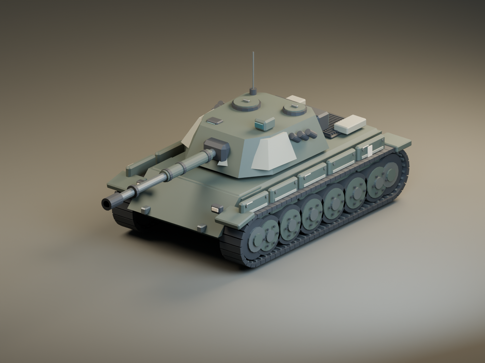

# IRON DUST — İlk tank varlığı

2026-10-23 · Blender MCP ile üretilen özgün, modern kurgusal Industrial Low Poly tank. Mat zeytin zırh, köşeli kule, modüler yan plakalar, altı yol tekerleği/yan, motor ızgaraları ve seyrek kenar aşınmaları.

## Dosyalar

- [Düzenlenebilir Blender kaynağı](iron_dust_01.blend): `IRON_DUST_01` sahnesi, ayrı varlık ve stüdyo koleksiyonları. Önceki Blender sahnesi korunur.
- [Oyun aktarımı](iron_dust_01.glb): yalnızca tank hiyerarşisi ve çarpışma kutusu; stüdyo zemini, kamera ve ışıklar içermez.
- [Ön görünüm](previews/front.png) · [Yan görünüm](previews/side.png) · [Üç çeyrek](previews/three_quarter.png).
- [Kaynak model sayımı](model_stats.json), [GLB dosya incelemesi](glb_inspection.json), [hareket ve yeniden içe aktarım kontrolleri](validation.json).

## Ölçek ve aktarım sözleşmesi

| Alan | Teslim değeri |
|---|---|
| Blender | 5.2.1 LTS; metre, birim ölçeği 1 |
| Görünür üçgen | 14.512; doğrudan GLB indekslerinden de doğrulandı |
| Çarpışma | 12 üçgen, tek basit `COL_Hull` kutusu |
| Geometri / materyal | 42 görünür mesh, 8 PBR materyal; toplam 53 düğüm |
| Boyutlar | 4,16 m genişlik × 9,235 m namlu dahil uzunluk × 3,764 m anten dahil yükseklik |
| Blender sınırları | X: −2,08…2,08; Y: −5,95…3,285; Z: 0,0764…3,84 m |
| İleri / yukarı | Blender −Y / +Z; glTF +Z / +Y |
| Dışa aktarım | glTF 2.0 binary, `export_yup=True`, seçim, uygulanmış geometri ve özel özellikler |
| Dış dosya ihtiyacı | Yok; fotoğraf dokusu kullanılmadı |

Ölçüler bu ilk taslağın uygulama tercihidir; fizik kütlesini veya son araç ölçülerini kesinleştirmez. Kök orijini yer seviyesinde; palet altı yaklaşık 7,6 cm yukarıda. Oyun yerleşiminde bu mesafe dikkate alınmalı.

## Parçalar ve hareket

`TankRoot` altında `Hull`, `TurretPivot`, `LeftTrack`, `RightTrack` ve `CollisionProxies` bulunur. `ArmorPanels`, `EngineDeck`, `Exhausts` gövdeye; `TurretMesh` ve `GunPitchPivot` kuleye; `Barrel` ve `MuzzlePoint` namlu yükseliş pivotuna bağlıdır. Namlu kılıfı ve manşetleri de yükseliş grubundadır.

- Kule merkezi Blender (0; −0,25; 1,78), namlu yükseliş merkezi (0; −1,47; 2,30) m. Kule +Z çevresinde döner; namlu −X dönüşüyle yükselir.
- Tekerlek adları `Left_RoadWheel_01`…`06` ve `Right_RoadWheel_01`…`06`; aksları merkezlerinde, Blender yerel Z eksenleri aks doğrultusunda. Sabit göbek ayrıntıları kendi tekerleğine birleştirildi.
- Her düğümün `asset_node_id` özel alanı GLB `extras` içinde korunur. Blender yeniden içe aktarırken eklediği `.001` benzeri ad son eklerinden bağımsız eşleştirme sağlar; GLB düğüm adları da benzersizdir.
- `COL_Hull` için `collision_only=true`. Blender'da render dışında ve tel kafes olarak gösterilir. **GLB yükleyicisinde bu işaret okunup görünürlük kapatılmalı**; Blender render gizliliğinin motor tarafından uygulanacağı varsayılmamalı. Bu kutu Havok rigid body değildir.
- Palet baklaları statik görsel geometri olarak her yanın materyal gruplarında birleştirildi; ayrı fizik cisimleri yok. Palet dolaşımı/UV kaydırma, süspansiyon animasyonu, geri tepme ve oyun kontrolleri uygulanmadı. Hareketli palet için yöntem ve gerekirse geometri/UV revizyonu M2'de seçilecek.

## Doğrulama

Blender kaynağında ve GLB yeniden içe aktarımında 90° kule dönüşü, 15° namlu yükselişi ve 12 tekerleğin merkezlerini koruyarak döndürülmesi kontrol edildi. Namlu referansı doğru gruplarla hareket ederken gövde sabit kaldı. Ebeveynlik, materyal yuvaları ve düğüm konumları korundu; en büyük konum farkı 0 m. İçe aktarılan quaternion dönüşleri hareket kontrolünden önce Euler XYZ olarak çevrildi.

GLB başlığı, uzunluğu, benzersiz adları, dış dosya gerektirmemesi ve 14.512 + 12 üçgen sayımı dosyadan kontrol edildi. Ön, yan ve üç çeyrek renderlar görsel olarak incelendi. Renderlar Cycles 32 örnek, AgX ve stüdyo ışıklarıyla üretildi; oyun içi performans ölçümü değildir.

Babylon/Havok yükleme, sürüş, runtime materyal görünümü ve tarayıcı performansı bu model tesliminde doğrulanmadı. Çarpışma kutusu prototiptir; süspansiyon temas noktaları ve son fizik şekli M2'de ayarlanmalı.

## Kaynak ve lisans kaydı

Üretim: Codex, kullanıcının IRON DUST tarifi doğrultusunda Blender MCP üzerinden özgün geometri ve düğüm tabanlı materyaller. İndirilen model, kaplama, marka veya başka oyun varlığı kullanılmadı. Üçüncü taraf varlık lisansı gerektiren içerik yok. Projenin kendi varlıklarını yayınlama lisansı henüz belirlenmedi; bu teslim dosyası lisans seçmez.
