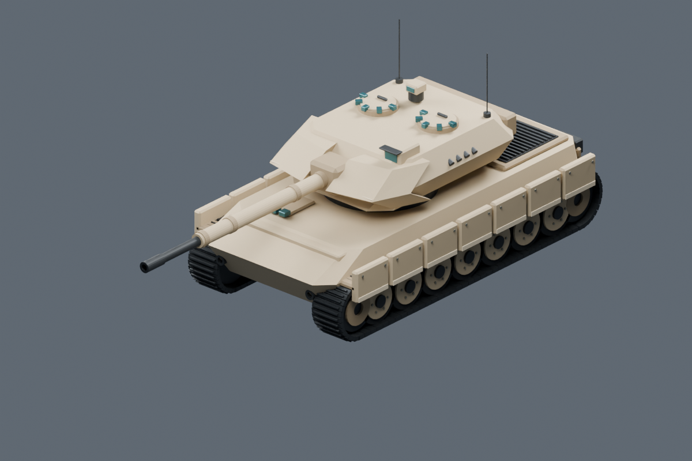

# IRON DUST 02 — ikinci tank varlığı

2026-10-26 · Bu proje için Blender ile üretilmiş özgün, kum beji Industrial Low Poly tank. Leopard 2A6 yalnızca tasarım esinidir; oyun modeli veya marka varlığı kullanılmadı.

## Teslim

- [Düzenlenebilir Blender kaynağı](iron_dust_02.blend) ve [oyun GLB'si](iron_dust_02.glb).
- [Ön](previews/front.png), [yan](previews/side.png), [arka](previews/rear.png), [üst](previews/top.png), [detay](previews/detail.png) ve [ilk tankla karşılaştırma](previews/comparison.png). `previews/blockout/` ilk oran taslağını kaydeder.
- [Model sayımı](model_stats.json), [kaynak ve GLB hareket doğrulaması](validation.json), [Havok sürüş sonucu](driving-results.json).

Görünür geometri 19.992 üçgen, çarpışma kutusu 12 üçgendir. Sekiz düğüm tabanlı materyal ve 14 yol tekeri/temas noktası vardır. `TankRoot`, `COL_Hull`, `TurretPivot`, `GunPitchPivot`, `GunRecoilRoot`, `MuzzlePoint` ve tekerlekler GLB özel alanlarıyla eşlenir. Palet UV'si geçici oyun shader'ı için hazırlanmıştır. Dış doku veya başka bir oyun varlığı kullanılmadı.

Blender 5.2.1 ile kaynak ve GLB yeniden içe aktarımı toplam 1.050 hareket pozunda kontrol edildi. `npm run tank:test`, `npm run turret:test` ve `npm run drive:test` iki tankı da gerçek GLB ile sınar. Tarayıcıda `map-preview.html?tank=02` ile seçilebilir; insan sürüş, nişan ve atış hissi kabulü açık. Bu kontroller performans ölçümü değildir.

Geometri ve materyaller bu proje için üretildi; üçüncü taraf varlık lisansı gerektiren içerik yok. Projenin yayın lisansı ayrıca belirlenir.
