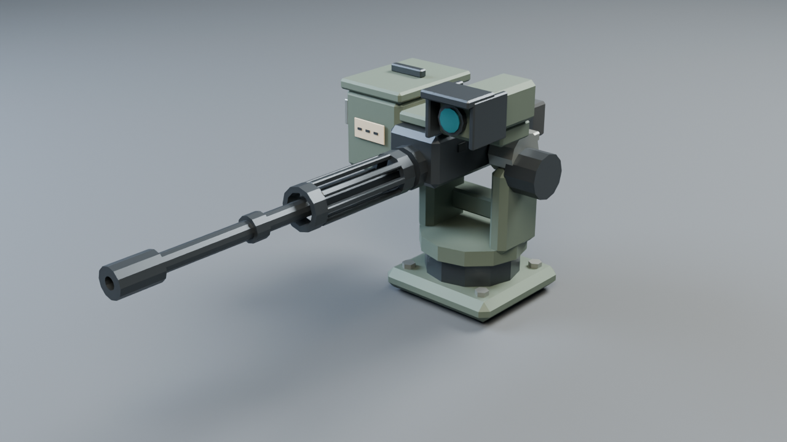

# IRON DUST — MG 02

2026-10-24 · Blender MCP ile sıfırdan tasarlanmış özgün, kameralı ikinci silah istasyonu.



Mevcut `iron_dust_mg_01` modelinden geometri, materyal veya hiyerarşi alınmadı. Eski silah ve tank klasörlerindeki 19 dosyanın SHA-256 değerleri işlem öncesi/sonrası eşleşti. Tank, yalnız ayrı montaj önizleme sahnesine referans olarak yüklendi.

## Teslim

- [Düzenlenebilir Blender kaynağı](iron_dust_mg_02.blend): `MG02_AssetStudio` ve `MG02_MountedPreview` sahneleri.
- [Yalnız silahı içeren GLB](iron_dust_mg_02.glb): tank, ışık, zemin ve render kamerası içermez; referans Empty nesneleri korunur.
- [Ön](previews/front.png), [yan](previews/side.png), [üç çeyrek](previews/hero.png), [mekanizma detayı](previews/detail.png).
- [Tank üzerinde](previews/mounted_third_person.png), [montaj yakını](previews/mounted_close.png), [16:9 POV](previews/pov.png).
- [Sol/aşağı](previews/pov_-60_-10.png), [sağ/aşağı](previews/pov_60_-10.png), [sol/yukarı](previews/pov_-60_45.png), [sağ/yukarı](previews/pov_60_45.png).
- [Sayısal doğrulama](validation.json) ve [mevcut dosyaların korunma kanıtı](preservation.json).

## Ölçek ve bağlantı

| Alan | Değer |
|---|---|
| Blender | 5.2.1 LTS; metre; birim ölçeği 1 |
| Görünür geometri | GLB indekslerinden sayılan 2.396 üçgen; 10 mesh; 6 PBR materyal; 17 düğüm |
| Boyut | 0,723 m genişlik × 1,625 m uzunluk × 0,7675 m yükseklik |
| İleri / yukarı | Blender −Y / +Z; yeniden aktarımda korunur; glTF +Z / +Y |
| Montaj ebeveyni | Tankın `TurretPivot` düğümü |
| Montaj dönüşümü | Blender yerel konum `(0.50, -0.85, 0.94)` m; dönüş `(0,0,0)`; ölçek `(1,1,1)` |
| Sıfır pozda tank üzerindeki dünya konumu | `(0.50, -1.10, 2.72)` m |
| Önerilen sınırlar | Kuleye göre yatay −60°…+60°; yükseliş −10°…+45° |
| Önerilen geri tepme | `MGRecoilRoot` yerel +Y yönünde 0,018 m |
| POV | 68° yatay görüş açısı; 16:9 |

Açılar varlıkta öneri metadata'sıdır; oyun kontrolünü veya fizik kısıtını uygulamaz. Motor montajında glTF eksen dönüşümü dikkate alınmalı; Blender konum değerleri Babylon yerel eksenlerine doğrudan kopyalanmamalı.

```text
MGMountRoot
├── MGBase
├── MGBaseDetails
└── MGYawPivot
    ├── MGSupport
    ├── MGCradleDetails
    └── MGPitchPivot
        ├── MGReceiver
        ├── MGAmmoBox
        ├── MGFeed
        ├── MGCameraHousing
        ├── MGCameraPoint
        ├── MGEjectionPoint
        └── MGRecoilRoot
            ├── MGBarrel
            ├── MGBarrelDetails
            └── MGMuzzlePoint
```

Yatay pivot Blender +Z çevresindedir. Yükseliş, Blender −X dönüşüdür. Küçük sabit ayrıntılar aynı hareket grubunda birleştirilmiştir; hareket grupları ayrı kalır. `asset_node_id` özel alanı yeniden içe aktarımda Blender ad son eklerinden bağımsız eşleştirme sağlar.

`MGCameraPoint`, yükseliş pivotuna göre `(0.18, -0.357, 0.19)` m; `MGMuzzlePoint` sıfır geri tepmede `(0, -1.351, 0)` m. Kamera namluya göre 0,18 m sağda, 0,994 m geride ve 0,19 m yukarıdadır. İkisinin ileri yönü −Y; yakın mesafe paralaks/nişan düzeltmesi oyun işidir. Kamera noktası lensin önündedir; geri tepmeden etkilenmez. POV'da namlu alt köşede görünür.

## Doğrulama ve sınırlar

- GLB temiz sahneye alındı: düğümler, gerçek ebeveynlik, materyal yuvası sayıları ve dünya matrisleri eşleşti. En büyük matris farkı 1,20 × 10⁻⁷.
- Kaynak ve yeniden aktarılan modelde yaw/yükseliş/geri tepme denetlendi. Kamera yaw/yükselişi takip eder, geri tepmede sabit kalır; namlu referansı geri tepmeyle taşınır.
- Tank geometrisine karşı 897 duruşta üçgen BVH yüzey kesişme taraması: **0 kesişme**. Ana kule 30° aralıklarla tam tur; MG yatay/dikey sınırları ve ara konumlar; ana top −8°/0°/+20° örnekleri. Sabit kulede MG taraması 5° aralıklı. Kesintisiz çarpışma garantisi değildir.
- Kaidenin dört bağlantı örneğinde tavanla boşluk 0 m. İlk yerleşimde optik muhafazasıyla kesişme bulundu; montajı öne ve içeri taşıyarak giderildi. Mevcut optikler ve kapaklar değiştirilmedi.
- Kamera merkez ışını silah geometrisiyle kesişmez. Önizlemeler Cycles 24 örnek/1280 × 720; dört POV sınır karesi 12 örnek/640 × 360. Görsel kabul ve tarayıcı performansı ayrı konulardır.
- Tankta kapak açılma rig'i bulunmadığından dinamik kapak açılma süpürmesi doğrulanmadı. Sabit kapak geometrisi kesişme taramasına dahildir; gelecekte kapak animasyonu eklenirse tekrar kontrol gerekir.
- Oyuna yükleme, ikinci silah seçimi, sürerken POV, nişan sınırlama, atış ve tracer uygulanmadı. M1/M2/M3 oyun kabulü bu varlıkla tamamlanmaz.

## Üretim ve kaynak

Üretici: Codex; kullanıcının IRON DUST tarifiyle Blender MCP üzerinden özgün geometri ve mat PBR materyaller. Dış model, fotoğraf, kaplama veya marka kullanılmadı. Tank yalnız proje içi referanstır. Üçüncü taraf varlık lisansı gerektiren içerik yok; proje yayın lisansı bu teslimle seçilmez.

Üretim, render ve doğrulama kaynakları `scripts/blender/*_machine_gun_02.py` altında. MCP `execute_blender_code_for_cli` aracına ilgili `.blend` yolu ve Python dosyasının içeriği verilerek çalıştırıldı. Üretim betiği yalnız izole background Blender sürecinde çalıştırılmalıdır; çalışma belleğini sıfırlar ve sadece MG 02 çıktılarını yazar. Render seçimi `MG02_VIEW` ortam değişkenidir. Varsayılan etkileşimli bağlantı zaman aşımına uğradığından ayrı stdio MCP istemcisi ve CLI aracı kullanıldı; masaüstü Blender oturumu kapatılmadı.
