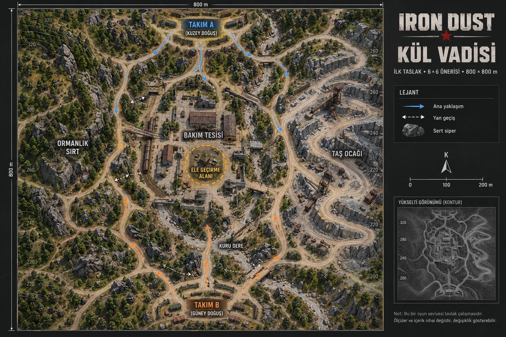

# Kül Vadisi — Harita geliştirme ve model üretim planı

İlk konsept: 2026-10-24. Son güncelleme: 2026-10-28.

**Durum:** 5’e 5 üs saldırısı düzeni onaylı. Kullanıcı mevcut Babylon.js motorunun korunmasını, küçük parçaların kodla üretilmesini ve projeye eklediği Quaternius doğa paketinden yararlanılmasını istedi. K0–K7 harita uygulaması ve 5’e 5 maç sistemi bu model tesliminin kapsamı değil. Kullanıcının sonraki açık isteğiyle B1 kapalı askerî bakım hangarı bağımsız Blender varlığı olarak üretildi; [teslim ve kontroller](../assets/environment/maintenance_hangar_01/README.md). Harita yerleşiminde son ölçü ve oyun içi kabul bekliyor.

## Kesin kararlar ve önceki planla ilişki

2026-10-28 konuşmasında kullanıcı aşağıdaki harita düzenini uygun buldu:

- İki takım, takım başına beş oyuncu; kuzey ve güneyde karşılıklı ana üsler.
- Üç ana yaklaşım: batıda ormanlık sırt, merkezde fabrika alanı, doğuda taş ocağı.
- Koridorlar arasında cephe değiştirmeye izin veren yan geçitler ve kuru dere bağlantıları.
- Her koridorda, her takım için bir büyük dış savunma binası; her üs girişinde üç yaklaşımın bağlandığı ortak iç savunma.
- Düşmanın bir koridorunu yararak ortak iç savunmayı aşmak ve komuta merkezini yok etmek kazanmak için yeterli. Diğer iki koridorun savunmalarını yıkmak zorunlu değil.
- Komuta merkezi ana hedef; korunaklı doğma hangarları bundan ayrı. Hangar çıkışları komuta merkezine saldıran düşmanın doğrudan atış hattında olmayacak.
- Üslerden üç cepheye dağılabilen, tek kapıda sıkışmayı önleyen çıkışlar.

Önceki plandaki **6’ya 6 ve merkezde tek ele geçirme alanı** önerilerinin yerini bu düzen alır. Yaklaşık 800 × 800 m ve ilk temasa 30–45 saniye önerileri son ölçü veya kabul koşulu değildir; tank hızı ve yol düzeniyle yeniden değerlendirilecek.

Bu belge gelecek çok oyunculu haritanın tasarımını tanımlar. Mevcut sürüş/savaş prototiplerinin veya LAN düellosunun 5’e 5 maç sistemini sağladığı anlamına gelmez. Açık M1/M2/M3 kabul maddeleri bu belgeyle kapanmaz.

## Kuşbakışı yerleşim

Aşağıdaki şema bağlantıları gösterir; ölçekli arazi veya bina yerleşim çizimi değildir.

```text
                     KUZEY ÜSSÜ — TAKIM A
                  Korunaklı doğma hangarları
                  Komuta merkezi (ayrı hedef)
                       Sevk avlusu
                     A iç savunması
                    /       |       \
            A batı dış   A orta dış   A doğu dış
              savunma      savunma      savunma
                 |            |            |
            ORMANLIK       FABRİKA        TAŞ
              SIRT          ALANI        OCAĞI
                 |── yan geçit ──|── yan geçit ──|
                 |            |            |
            B batı dış   B orta dış   B doğu dış
              savunma      savunma      savunma
                    \       |       /
                     B iç savunması
                       Sevk avlusu
                  Komuta merkezi (ayrı hedef)
                  Korunaklı doğma hangarları
                     GÜNEY ÜSSÜ — TAKIM B
```

Şemadaki hangar ve komuta merkezi sıralaması işlevsel katmanları anlatır. Gerçek yerleşimde yana kaydırılmış binalar, toprak setler ve kırılan yollar doğma alanına düz atış hattı oluşmasını önlemeli. Yan geçitlerin sayısı ve tam konumu henüz belirlenmedi.

### Önceki görsel referans



2026-10-24 tarihli görsel bu proje için imagegen ile üretildi ve kullanıcı tarafından seçildi; dış oyundan varlık alınmadı. Orman, sanayi ve taş ocağı kimliği için referanstır. Yeni üsler ve savunma zinciri bu eski görselde gösterilmiş kabul edilmez. Görseldeki kontur rakamları, yol genişlikleri ve bina ölçüleri üretim verisi değildir.

## Bölge kimliği ve çatışma düzeni

Ormanlık tepeler arasında, eski taş ocağına ve yük demiryoluna hizmet veren sanayi vadisi. Industrial Low Poly dilinde mat zeytin yeşili, tozlu toprak, grafit kaya ve paslı metal kullanılır. Fırtınalı atmosfer görüş okunabilirliğini bozmamalı.

| Bölge | Yerleşim | Oyun işlevi |
|---|---|---|
| Batı — ormanlık sırt | Büyük kayalar, kırılan yollar, alçak sırtlar ve ağaç kümeleri | Gövde saklama, konum değiştirerek ilerleme ve yan saldırı. Atış noktalarının dolaşılabilir arka/yan yaklaşımı olmalı. |
| Merkez — fabrika alanı | Bakım hangarları, atölyeler, avlular ve yük vagonları | Üsler arasındaki en kısa yaklaşım; yakın çatışma ve yoğun baskı. Yapılar uzun düz atış hattını bölmeli. |
| Doğu — taş ocağı | Sürülebilen basamaklar, servis yolları, kaya ve yükleme alanları | Daha uzun görüşler, yükselti kullanımı ve riskli açık alan geçişleri. Tek bir basamak bütün bölgeye hükmetmemeli. |
| Yan bağlantılar — kuru dere ve servis geçitleri | Ana yollar arasında kısmen gizli hareket | Takviye, kuşatma ve geri çekilme. Çıkışları açıkta veya karşı konumdan görülebilir; bedelsiz güvenli kestirme olmamalı. |
| Kuzey/güney — ana üsler | Ayrı doğma hangarları, sevk avlusu, komuta merkezi ve savunma girişi | Cepheye dağılım, son savunma ve maçın nihai hedefi. |

Oyuncular belirli bir koridora veya sabit role atanmış sayılmaz. Beş oyuncunun üç yola nasıl dağılacağı takım kararıdır; tank sınıfları veya zorunlu 2–1–2 dağılımı bu planın kararı değildir.

## Ana üs düzeni

Her üs aşağıdaki işlevleri taşımalı:

1. **Doğma hangarları:** Üssün arkasında korunaklı tank çıkışları. Görünüş olarak büyük zırhlı birlik tesisinin parçası; tek dar boğaza bağlı değiller. Doğma sıklığı, koruma ve kapı davranışı henüz kararlaştırılmadı.
2. **Sevk avlusu:** Hangarlardan çıkan araçların farklı cephelere dağılabildiği geniş manevra alanı. Beş tank birbirini zorunlu olarak bloke etmemeli.
3. **Komuta merkezi:** Büyük, kolay tanınan beton ana hedef; hangarların önünde ve yana kaydırılmış. İmhası maçı bitirir. Görsel hasar aşamaları ve can değerleri açık.
4. **Ortak iç savunma:** Üç koridorun üs yaklaşımında bağlandığı son savunma. Dış savunması kırılan bir yoldan bunun aşılması, komuta merkezine saldırı yolunu açar.
5. **Çıkış siperleri:** Beton duvarlar ve toprak setler düz görüşü keser; doğan oyuncunun en az alternatif bir hareket seçeneği olmalı.

Dağa gömülü üs veya açık tank fabrikası görünümü henüz seçilmedi. Bu iki görsel seçenekten biri kesin kullanıcı kararı gibi modellenmeyecek.

## Savunma binaları ve ilerleme

İlk düzende takım başına üç dış savunma binası, bir ortak iç savunma ve bir komuta merkezi vardır. Koridor savunması küçük, tek başına duran bir top yerine **büyük beton savunma yapısı** olarak okunmalı; top bunun üstünde veya önünde yer alabilir.

Örnek kazanma yolu:

**Batı koridorundaki düşman dış savunmasını yık → üs girişindeki ortak iç savunmayı aş → komuta merkezini yok et.**

Orta ve doğu dış savunmaları ayakta kalsa da maç kazanılabilir. Bu, savunan takımın diğer cephelerden geri dönmesini ve saldıran takımın yan güvenliğini düşünmesini gerektirir.

### Henüz kesinleşmeyen savunma mekanikleri

- Topun otomatik hedef seçimi, dönüş hızı, menzil, ateş hazırlığı, dolum ve hasarı.
- Önden güçlü, yandan zayıf zırh; dikkat çekip yandan vurma davranışı önceki konuşmada önerildi, sayısal sistem onaylanmadı.
- Hedefe erişim ile hasar kilidinin ilişkisi: sıradaki yapıya erken veya yandan ateş etmenin engellenip engellenmeyeceği ayrıca kararlaştırılacak. Haritanın görüş ve erişim düzeni savunma sırasını desteklemeli.
- Yıkılan yapının enkaz olarak siper oluşturması öneridir; geçişi kalıcı kapatacak fiziksel yıkım taahhüdü değildir.

## Diğer yapılar

| Yapı | Yerleşim ve amaç | Durum |
|---|---|---|
| Büyük hangar ve atölyeler | Fabrikada görüşü bölmek, çevresinden dolaşmak ve alternatif yaklaşım oluşturmak | İlk bakım hangarı kapalı askerî tesis olarak seçildi ve modellendi; çevresinden dolaşılır. Atölye ve son yerleşim ölçüleri açık |
| Depo ve vagonlar | Avluda siper, yön bulma ve atış hattını bölme | Çevre yerleşimi; kesin adetler açık |
| Konveyör ve yükleme haznesi | Taş ocağının silüeti ve bölge kimliği | Çevre önerisi; üretim sırası aşağıda |
| İleri bakım/onarım hangarı | Cepheye yakın onarım ve bunun kaybıyla geri çekilme ihtiyacı | Oynanış önerisi; onarım sistemi ve yıkılma etkisi onaylanmadı |

Her bina yıkılabilir hedef olmayacak. Sert siper, yalnız görsel dekor ve maç hedefi ayrımı yerleşimde okunmalı. Düzenli çıkan dost konvoyları da önceki konuşmanın önerisidir; bu harita onayıyla uygulanacak mekanik sayılmaz.

## Denge ve oynanış ilkeleri

- Üç yol birbirinden kopuk olmayacak; cephe değiştirmek zaman, açık alan geçişi veya avantajlı konumu bırakma bedeli taşımalı.
- Merkez kısa yol olsa da kesintisiz üsler arası atış hattı vermemeli.
- Hiçbir tepe üç koridoru, bir üssün bütün çıkışlarını veya tüm hedefleri birlikte kontrol etmemeli.
- İki takımın ilk temas, koridora erişim ve savunmaya dönüş olanakları dengelenmeli. Aynı görünen iki yarı şart değil; erişim avantajları karşılaştırılmalı.
- Doğma çıkışlarına uzaktan doğrudan ateş engellenmeli. Kuşatmada savunan takımın çıkış ve karşı saldırı seçeneği olmalı.
- Kaya, beton ve toprak set gerçek siper olarak okunmalı; ağaç yapraklarının görüş örtmesi mermiyi durdurmasıyla karıştırılmamalı.
- Yol ve avlularda tankların karşılaşma, geri çekilme ve dönüş payı bulunmalı; ayrıntılı dekor hareketi istemeden tıkamamalı.
- Yapı sayısı cephe ilerlemesini görünür kılmalı; maç sürekli hareketsiz binalara ateş etmekten oluşmamalı.

## Üç üretim kanalı

**Kesin kullanıcı tercihi:** Babylon.js + Havok korunur; ikinci render motoru veya Three.js bağımlılığı eklenmez. Küçük parçalar Babylon.js içinde kodla oluşturulur. Kullanıcının sağladığı Quaternius paketi gereken doğa modellerinde kullanılabilir.

**Önerilen ayrım:** Modelin boyutundan çok silüet, tekrar ve oynanış işlevi belirleyici. Karakteristik yapılar Blender MCP ile; basit ve ölçüsü sık değişen parçalar kodla; uygun doğa varlıkları hazır paketten gelir. Bütün harita tek Blender sahnesi/GLB olarak teslim edilmez.

| Kanal | İşler | Sınır |
|---|---|---|
| Babylon.js — kodla üretim | Arazi, yollar, kuru dere, sürülebilen ocak basamakları, basit siper/dekor, yerleşim ve tekrarlar | Oynanışı etkileyen ölçüler kolay değiştirilebilir; görünür yüzey ile fizik aynı arazi verisini kullanır |
| Blender MCP — özgün üretim | Üsler, büyük savunma yapıları, fabrika, özel ocak duvarı ve sanayi donanımı | Her varlık ayrı kaynak/çıktı; detaydan önce oyun içi ölçek ve silüet kontrolü |
| Quaternius — seçip uyarlama | Çam, geniş yapraklı/kuru ağaç, çalı, ot, orta kaya ve çakıl | Seçilen modeller ve gerekli dokular alınır; paketin tümü oyuna yüklenmez |

### Mevcut koddan kullanılacaklar

- `src/game/world/terrain.ts`: mevcut yükseklik, eğim ve sabit tohum yaklaşımı. Mevcut test haritasının ölçüleri yeni haritanın ölçüsü kabul edilmez.
- `src/game/world/createTestGround.ts`: metre ölçeği, Havok statik çarpışmaları, tekrar kullanılan bitki geometrileri ve kaynak temizleme örneği. Mevcut sürüş test sahası korunur.
- `src/game/world/terrainSurfaceTextures.ts` ve `SkyAtmosphere.ts`: mevcut zemin ve atmosfer başlangıç alınır; yeni bir kaplama/gökyüzü sistemi bu iş için gerekmez.
- `src/mapPreview.ts`: mevcut tankla önizleme entegrasyon noktası; yeni yerleşim mevcut testleri bozmadan ayrı seçilebilir olmalı. Seçim arayüzü uygulamada belirlenir.

Yeni haritada üsler, koridorlar, yollar, hedef kimlikleri ve yerleşim konumları aynı tanımdan beslenecek. Sabit tohum dekorun her açılışta değişmesini önleyecek; ana siperler ve yollar rastgele dağıtılmayacak. İlk aşamada görsel harita editörü veya genel amaçlı varlık sistemi yapılmayacak.

## Hazır doğa paketi — Quaternius

**Yerel kaynak:** `Stylized Nature MegaKit[Standard]/`. Kaynak değiştirilmeden korunacak.

**Kaynak ve lisans:** [Stylized Nature MegaKit — Quaternius](https://quaternius.itch.io/stylized-nature-megakit), CC0 1.0. Yerel `License_Standard.txt` bunu doğruluyor. 2026-10-28 incelemesinde Standard klasöründe **68 glTF model** bulundu; ürün sayfasındaki 116 model tüm paketin kapsamı, yerel Standard sürümün envanteri değildir. Kaynak pakette FBX ve OBJ seçenekleri de var; oyun için ilk aday mevcut glTF dosyaları.

### İlk seçki — oyun içi görünüm kabulü bekliyor

Aşağıdaki dosyalar yerel `glTF/` klasöründe mevcut. Bunlar üretim adaylarıdır; tarayıcıda uygun bulunduğu iddia edilmez.

| Dosya adı | Bölge / görev | Seçim nedeni |
|---|---|---|
| `Pine_1.gltf`, `Pine_3.gltf` | Batı sırtı, çevre ormanı | İki farklı çam silüetiyle tekrarın kırılması |
| `CommonTree_1.gltf` | Dere kıyısı ve seyrek geçiş alanları | Çam ormanına ölçülü çeşitlilik |
| `DeadTree_1.gltf` | Ocak ve fabrika kenarı | Terk edilmiş sanayi vadisi kimliği; seyrek kullanım |
| `Rock_Medium_1.gltf`, `Rock_Medium_2.gltf`, `Rock_Medium_3.gltf` | Yol kenarı ve kaya kümeleri | Hazır düşük detaylı kaya çeşitleri; siper için boyut kontrolü şart |
| `Bush_Common.gltf` | Orman kenarı ve dere | Sert siper olmayan görüş örtüsü |
| `Grass_Common_Short.gltf`, `Grass_Wispy_Short.gltf` | Yakın çevrede seyrek ot | Yol ve hedef okunabilirliğini bozmayan zemin ayrıntısı |
| `Pebble_Round_1.gltf`, `Pebble_Square_1.gltf` | Yakın yol/ocak kenarı | Küçük taş ayrıntısı; çarpışma gövdesi gerektirmez |

İlk seçki **12 model**. Çiçekler, mantarlar, döşeme taşları ve belirgin fantastik burulmuş ağaçlar başlangıç kapsamına alınmaz. Yeni doğa modeli ihtiyacı doğarsa önce paketin kalan modellerine bakılır.

### Uyarlama ve aktarım

1. Seçilen glTF dosyalarını bağlı `.bin` ve görselleriyle birlikte incele. Göreli yollar korunmalı; tek başına `.gltf` kopyalamak teslim sayılmaz. Gerekirse yalnız seçilenleri GLB olarak paketle.
2. Tankın yanında ölçek, zemin başlangıç noktası, eksen, normal ve yaprak saydamlığını kontrol et. Unity/Godot/Unreal shader'larının Babylon.js'e taşınmış olduğu varsayılmaz.
3. Yaprakları soluk zeytin yeşiline, kayaları grafit/toprak paletine yaklaştır. Kaynak dokuyu değiştirmek yerine oyun kopyasında ayar yap; aydınlatma altında tankla birlikte karşılaştır.
4. Kayaya basit statik çarpışma; gerekli ağaç gövdelerine basit gövde şekli önerilir. Yaprak, çalı, ot ve çakıl ilk aşamada tankı veya mermiyi durdurmaz. Gövde/mermi davranışı K0'da açıkça kaydedilir.
5. Aynı modelleri ortak geometri/materyalle çoğalt; yakın/uzak bitki ayrımı ve seyrek uzak orman kullan. Tekrar çizimi fizik gövdelerini kendiliğinden azaltmaz; çarpışma yerleşimi ayrıca sınırlanır.
6. Seçilen dosyalar, kaynak sürüm, yapılan değişiklikler ve CC0 lisansı önerilen `assets/environment/quaternius_nature/` teslim kaydında tutulur. Dağıtıma yalnız kullanılan dosyalar ve bağımlılıkları girer.

**Dosya incelemesi:** İlk seçkide glTF'nin referans verdiği tampon/görsel dosyalarında eksik bulunmadı. Üçgen indekslerinden hesaplanan örnekler: `Pine_1` 3.947, `Pine_3` 4.964, `CommonTree_1` 6.265; üç orta kaya sırasıyla 342, 244 ve 522 üçgen. Bu sayılar FPS sonucu değildir. Çok sayıda ağaçta geometri, yaprak saydamlığı ve gölge maliyeti birlikte ölçülecek; uzak çevre için sadeleştirme gerekebilir.

## Blender MCP ile üretilecek özgün modeller

| Paket | Modeller | Oyun işlevi / öncelik |
|---|---|---|
| B1 — merkez fabrika | Büyük bakım hangarı, küçük atölye | İlk gerçek model kesiti; yakın çatışma, görüş kesme ve dolaşılabilir cepheler |
| B2 — savunma ve üs | Büyük dış savunma yapısı, ortak iç savunma, komuta merkezi | Koridor ilerlemesini ve nihai hedefi ayırt eden özgün silüetler |
| B2 — doğma alanı | Korunaklı doğma hangarı için B1 hangarından varyant; gerekirse ayrı model | Ayrı çıkışlar ve tank manevrası; üs mimarisi seçilmeden son detay yapılmaz |
| B3 — özel kaya seti | Modüler dik ocak duvarı, gerekirse uzun kaya sırtı | Hazır orta kayaların karşılamadığı büyük şekiller; sürülebilen basamak zemini kodda kalır |
| B4 — sanayi kimliği | Yük vagonu, konveyör ve yükleme haznesi | Bölgeler oynanabilir olduktan sonra yön bulma ve silüet |
| Gerektiğinde | İdari bina, kırık beton parça veya kum torbası kümesi | Yeni oynanış/görsel ihtiyaç kanıtlanırsa; ilk zorunlu paket değil |

**Tekrar kullanımı:** Bir dış savunma temel modeli altı dış savunma yerleşimine hizmet edebilir. İç savunma ve komuta merkezi de takım başına ayrı yeniden modellenmez; takım işareti ve kontrollü yerleşim varyasyonları kullanılır. Hasar davranışı modelden ayrı kalır.

**İlk Blender işi:** B1 içindeki hangar ve atölye; ardından B2 dış savunma yapısı. Doğa paketinde uygun kaya/ağaç bulunduğu için eski 15 özgün çevre modeli önerisi artık başlangıç üretim listesi değildir.

**2026-10-28 B1 başlangıcı:** Kullanıcı kapalı askerî bakım tesisi seçti ve Blender MCP ile modellemeyi açıkça istedi. İlk hangar 32 × 22 m ana hacim, alçak yan servis kanadı, kademeli çatı ve kapalı sürgülü kapıyla üretildi. Mat zeytin yeşili metal, beton kaide ve seyrek uyarı işaretleri kullanıldı. Bu ölçüler ilk model taslağıdır; K0/K1 harita yerleşimi sınanmadan bağımsız varlık üretimine geçilmesi bu isteğin kapsamıdır. Atölye ve savunma yapıları henüz üretilmedi; K2 kabulü tamamlanmadı.

### Blender MCP üretim döngüsü

- Üretim başladığında gerçek sahne özeti çağrısıyla bağlantıyı doğrula; araç listesi/port tek başına kanıt değildir. B1 üretiminde ayrı köprüyle gerçek sahne sorgusu ve model işlemleri doğrulandı.
- Mevcut tank, kabin ve silah sahnelerini değiştirmeden ayrı çevre çalışma dosyası kullan.
- Her varlık için sırayla: kaba hacim → ölçülü silüet → mat malzeme → basit çarpışma → GLB aktarımı → yeniden içe aktarım → Babylon.js içinde tankla karşılaştırma.
- Savunma topu hareket edecekse gövde, yatay dönüş ve namlu gruplarını ayrı tut; pivotlar doğru olsun. Model hazır olması otomatik hedefleme/ateş sisteminin hazır olduğu anlamına gelmez.
- İlk kabul edilen modeli çoğaltılabilir teslim standardı yap; bütün paketi bitirip sonra ilk kez motora yükleme.
- Her özgün varlık için `.blend`, `.glb`, önizleme ve kısa teslim kaydı önerilen `assets/environment/` altında tutulur. Var olan tank üretim betikleri çevre varlığı üreticisi gibi kullanılmaz.

## Babylon.js ile üretilecek parçalar

| Grup | Kodla üretilecekler | Çarpışma / kullanım önerisi |
|---|---|---|
| Ana arazi | Tepeler, sürülebilen ocak basamakları, kuru dere, yol eğimleri, toprak setler | Görsel ve fizik aynı yüzey tanımından; yol değişikliği Blender gerektirmez |
| Beton seti | Düz duvar, köşe, basit bariyer, kapı direği | Gerçek sert siper; basit statik şekiller. Özel kırık silüet gerekirse Blender |
| Küçük sanayi dekoru | Varil, sandık, basit paletli yük, boru grubu | Tekrar kullanılabilir kutu/silindir geometrisi; varsayılan görsel dekor |
| Çizgisel parçalar | Düz ray/travers tekrarları, çit direği, elektrik direği/kablo, tabela | Rotaya göre yerleşim; küçük elemanlar tankı takmaz. Karmaşık makas sistemi başlangıçta yok |
| İşaret ve yüzey ayrıntısı | Takım renkleri, yol/zemin renk geçişleri, basit numara/tabelalar | Ortak malzeme/doku; takım kimliği yalnız renge bağlı olmamalı |
| Yerleşim | Doğa kümeleri, bina tekrarları, bölge bazlı dekor yoğunluğu | Ana yollar/kapılar/atış alanları için boş bırakılan bölgeler |

Küçük görsel varil tek başına sert siper gibi sunulmayacak. Paletli yük veya dekor sonradan siper olacaksa hem görsel dili hem çarpışma/mermi kuralı birlikte değiştirilecek. Ayrıntılı fiziksel dekor ve tek tek kum torbası fiziği yapılmayacak.

## Geliştirme sırası ve teslim kapıları

Aşağıdaki aşamaların tamamı **planlandı, başlanmadı** durumunda. Harita üretimi önce yerel sürüş/atış önizlemesinde ilerler; 5’e 5 ağ ve maç kuralları çevre modellemesinin ön koşulu değildir.

| Aşama | İş | Somut teslim ve bitiş kontrolü |
|---|---|---|
| K0 — ölçü ve davranış | Tank genişliği/uzunluğu/dönüşünü ölç; harita ölçüsü, yol/kapı genişliği, temel yükselti ve siper davranışını ilk taslak olarak kaydet | Ölçülü yerleşim şeması, geçici değer listesi ve sert siper/görsel örtü/maç hedefi ayrımı. 800 × 800 m veya 30–45 s kendiliğinden kesinleşmez |
| K1 — bütün haritanın kaba yerleşimi | Babylon ile iki üs, üç koridor, yan geçitler, arazi ve hedefleri basit hacimlerle kur | Altı dış savunma, iki ortak iç savunma ve iki komuta merkezi işaretli; hangarlar ayrı. Her yol sürülebilir, doğma çıkışına düz atış yok; erişim ve dönüş süreleri iki taraftan kaydedilmiş |
| K2 — tek oynanabilir fabrika kesiti | B1 hangar/atölye, bir B2 dış savunma, kod beton seti ve seçili hazır kaya/bitkiyi aynı kesitte birleştir | Siper arkasında durma, bina çevresinden dolaşma, geri çekilme ve yan geçiş gerçek tankla denenmiş. Ölçek, malzeme, çarpışma ve kamera kabulü; ilk performans kaydı |
| K3 — üs ve savunma seti | İç savunma, komuta merkezi ve korunaklı hangar varyantını üret; iki üsse ve altı dış savunmaya uygula | Hedefler birbirinden tanınır; çıkışlar/manzara korunur. Beş tankın sevk avlusunda manevrası yerel araç yerleşimleriyle incelenir; ağ oturumu testi sayılmaz |
| K4 — batı ormanı ve doğu ocağı | Quaternius seçkisini yerleştir; gerekli özel ocak duvarını üret; bütün bağlantıları tamamla | İki yöne sürüş ve bölgeler arası geçiş; tepeler tek başına tüm haritaya hâkim değil. Bitkiler hedefleri aşırı örtmez, sert siper davranışı tutarlı |
| K5 — sanayi ve küçük dekor | B4 vagon/konveyör/hazne, kod ray ve küçük dekor | Bölge kimlikleri okunur; sonradan eklenen dekor geçitleri kapatmaz. Her dekorun somut işlevi var; kullanılmayan çeşitler eklenmez |
| K6 — çevre teslimi | Yükleme, kaynak temizliği, görünüm ve performansı denetle; gerekli yoğunluk/uzaklık sadeleştirmesini yap | Model/lisans listesi, kontrol kayıtları ve cihaz/tarayıcı/çözünürlük/kalite bilgisi. Sürüş ve atış önizlemesinde gezi; 5’e 5 dengesi henüz onaylı değil |
| K7 — ayrı maç entegrasyonu | Savunma hedeflerini maç kurallarına bağla; onaylanan yeniden doğma ve hedef/hasar sırasını uygula; 5’e 5 oturumda dene | Tek koridor yarılarak kazanma, cephe değişimi, yığılma ve kuşatma sınanmış. Ağ kapsamı ve açık mekanikler ayrıca kararlaştırılmadan bu adım uygulanmaz |

**Önerilen ilk uygulama teslimi K0 + K1:** Mevcut tankla gezilebilen, yolları ve hedef hacimleri görülen Kül Vadisi. Ayrıntılı Blender üretimine geçiş K1 yol/görüş kontrolünden sonra; bütün varlıkları önceden üretmek gerekmez.

### Aşamaya göre doğrulama

- K1/K4 arazi değişikliklerinde mevcut `npm run map:check`, `npm run map:test`, `npm run drive:test` ve `npm run map:build` ilgili kontrollerdir. Yeni haritayı gerçekten kapsaması gereken arazi/fizik kontrolleri uygulama sırasında uyarlanır; mevcut testin geçmesi yeni harita kabulü sayılmaz.
- K2/K3 modellerinde ölçek, pivot, görünmez çarpışma ve geçit kenarları kontrol edilir. Yeni otomatik kontrol yalnız somut fizik/hesaplama veya tekrar edebilecek hata için eklenir.
- K1–K6 boyunca tank yüksekliğinden ve yüksek konumlardan görüş; kamera kesişmesi, dönüş, eğim ve geri çekilme tarayıcıda incelenir. Süreler koordinat mesafesinden tahmin edilmez, sürülerek ölçülür.
- K6'da iki üs, merkez fabrika, yoğun orman ve açık ocaktan aynı koşullarda ölçüm alınır. Sayısal performans bütçesi referans cihaz ve hedef belirlendikten sonra yazılır.
- K7 maç kuralları çevre dosyalarından bağımsız anlamlı durum geçişi kontrolleriyle sınanır. Yerel tek tank gezisi 5’e 5 denge doğrulaması değildir.

## Model teslim ve entegrasyon kuralları

- Mevcut tankla aynı metre ölçeği; kapı, geçit, dönüş ve siper ölçülerini gerçek tankla kontrol et.
- Tutarlı İngilizce dosya/nesne adları, doğru dönüş merkezleri ve yerleştirmeye uygun başlangıç noktaları kullan.
- Industrial Low Poly dilini, mat malzemeleri ve güçlü silüetleri koru.
- Blender `.blend` kaynağı ile oyun için `.glb` çıktısını sakla.
- Görünür geometriden ayrı, basit çarpışma geometrisi hazırla; sert siper ile görsel dekor davranışını açıkça tanımla.
- Modüler duvar ve ocak parçalarının birleşimlerini kontrol et; tankın takılacağı görünmez kenarlar bırakma.
- Her varlığın kaynağını, lisansını, geçici durumunu ve teslim kontrollerini kaydet. Mevcut tank/silah dosyalarını koru.
- Çevre üçgen, materyal ve doku bütçelerini referans cihazdaki ölçümle belirle; henüz kesin bütçe yok.
- Kapsamlı fiziksel bina yıkımı bu planın kapsamında değil.

## Açık kararlar

- Son harita ölçüsü, yol genişlikleri, yükseltiler ve bölgeler arası mesafeler.
- Maç süresi hedefi, yeniden doğma olup olmayacağı, bekleme süresi ve üs koruma yöntemi.
- Savunma binalarının can/ateş değerleri, hedef önceliği ve yapıların hasar alma koşulları.
- Komuta merkezinin hasara açılma kuralı; aynı anda iki merkezin imhasında sonuç.
- Onarım hangarları, konvoylar ve bunların maçtaki görevleri.
- Üslerin son mimarisi, hangar içleri ve kapı davranışı.
- Harita sınırları, küçük dekor çarpışmaları ve mermi engelleme özellikleri.
- Referans cihaz, çevre üçgen/materyal bütçesi ve ağ uygulama kapsamı.

## Uygulama öncesi ve sonrası kabul kontrolleri

Önce yollar, siperler, üsler ve hedef binaları basit hacimlerle yerleştirilecek. Ayrıntılı Blender üretimi bu yerleşim sınanmadan başlamamalı.

- İki taraftan her koridora ilk temas, yan geçiş ve üs savunmasına dönüş sürelerini gerçek tankla ölç.
- Kapıları, dönüşleri, eğimleri, geri çekilmeyi ve avluda birden fazla tankın hareketini sürerek kontrol et.
- Merkezden veya yüksek konumlardan doğma hangarlarına doğrudan atış hattı bulunmadığını incele.
- Her baskın konuma alternatif yaklaşım olduğunu; yan geçitlerin de karşı oyun sunduğunu kontrol et.
- Bir koridorun dış savunması ve ortak iç savunma aşıldığında, diğer dış savunmalar ayaktayken komuta merkezine ulaşılıp maç kazanılabildiğini doğrula.
- Maç kuralları uygulanınca yapıların hedef/hasar sırası ve kazanma durumunu anlamlı otomatik kontrollerle doğrula.
- 5’e 5 oturumda bütün takımın tek yola yığılması, cephe değiştirme ve üs kuşatması senaryolarını oyna; sonuçlara göre mesafe ve siperleri ayarla.
- Kamera kesişmeleri, görüş okunabilirliği ve performansı cihaz/tarayıcı/çözünürlük/kalite bilgisiyle kaydet.

**Bu belge güncellemesinde:** Mevcut dünya kodu ve proje belgeleri incelendi; üretim üç kanala ayrıldı ve K0–K7 teslim/kabul sırası yazıldı. Yerel Quaternius Standard paketi, lisansı, ilk seçkinin dosyaları ve glTF bağımlılıkları incelendi; yayıncı sayfasındaki lisans doğrulandı. Belge bağlantıları ve diff kontrolü yapıldı. Oyun testi, varlık aktarımı, Blender bağlantı/üretim kontrolü veya 5’e 5 denge testi yapılmadı. Harita onayı ve belge teslimi, uygulama veya oynanış kabulü değildir.
